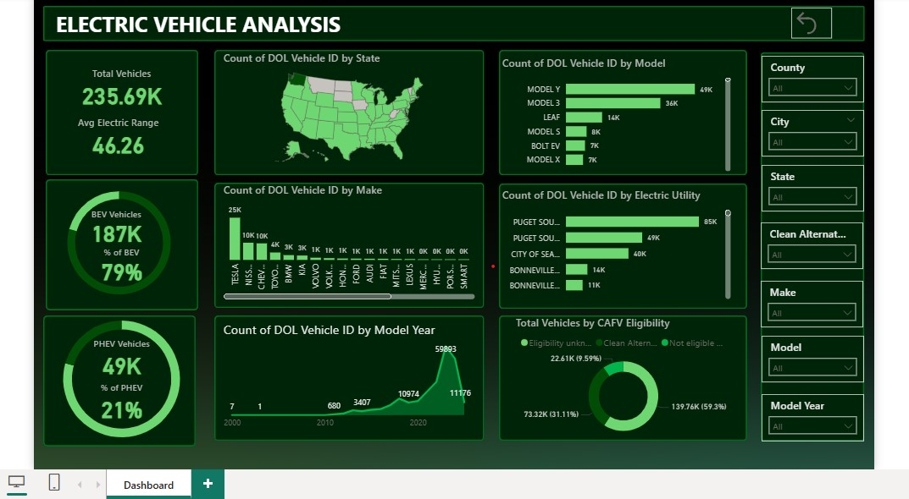
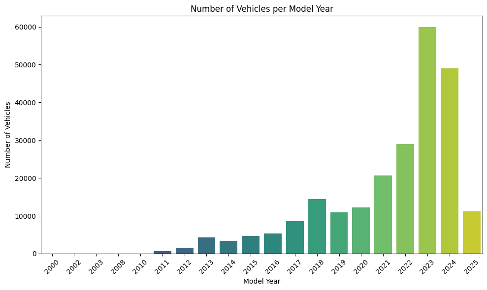
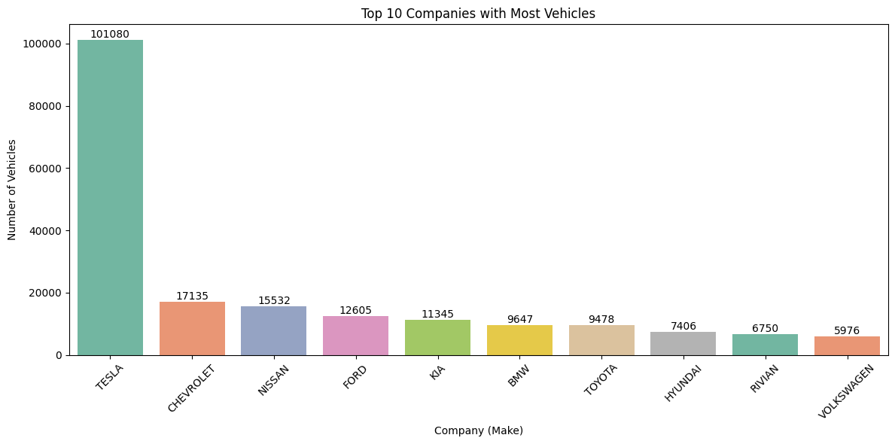
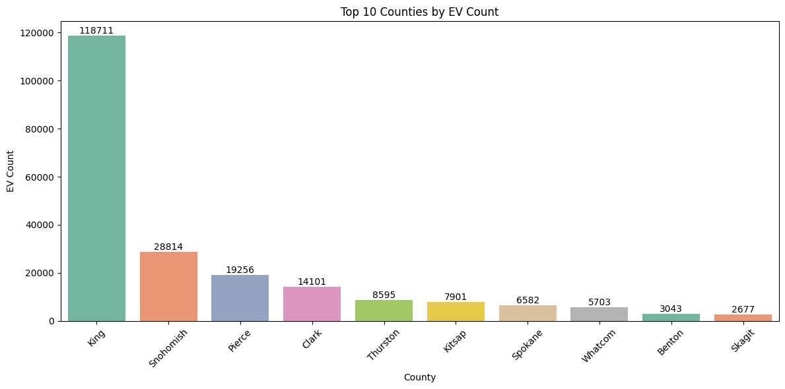
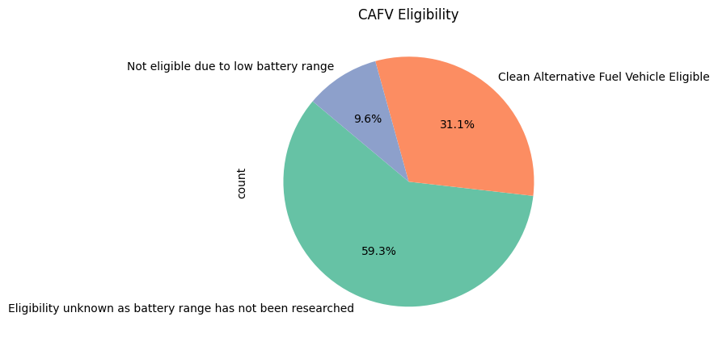

# Electric Vehicle Population Analysis


Exploratory analysis and an interactive **Power BI dashboard** of **235,692 electric vehicles** from the Washington State Department of Licensing records. It looks at adoption over time, the most common makes and models, battery vs. plug-in hybrid mix, where vehicles are concentrated, and clean-fuel incentive eligibility.

## Dashboard preview



The dashboard has KPI cards (total vehicles, average electric range), BEV vs. PHEV share, vehicles by state, model, make, electric utility and model year, a CAFV eligibility breakdown, and slicers for county, city, state, clean-fuel eligibility, make, model and model year.

## Key findings

| Finding | Evidence |
|---|---|
| **Adoption keeps rising** | Registrations grow almost every year and peak at about **60,000 vehicles for model year 2023** (about 49,000 for 2024; 2025 is a partial year) |
| **Tesla dominates the market** | **101,080 vehicles, about 43%** of the dataset. Next are Chevrolet (17,135), Nissan (15,532), Ford (12,605) and Kia (11,345) |
| **Two Tesla models lead** | **Model Y (49,253)** and **Model 3 (36,065)**; the Nissan Leaf is third (13,814) |
| **Battery electric is the majority** | **79.3% BEV** (186,998) vs. **20.7% PHEV** (48,694) |
| **Very concentrated geography** | **King County (the Seattle area) holds 118,711 vehicles, about half of all EVs.** Snohomish (28,814) and Pierce (19,256) follow. The most common ZIP code is 98052 |
| **Most incentive eligibility is unknown** | Only **31.1%** of vehicles are confirmed Clean Alternative Fuel Vehicle eligible, **9.6%** are not eligible, and **59.3%** are unknown because battery range has not been researched |

## Charts

**EVs per model year**



**Top 10 makes**



**Top 10 counties**



**Clean-fuel incentive (CAFV) eligibility**



## Data limitations

- **Electric range is 0 for roughly 60% of vehicles.** The range was never researched for these records, so the dashboard's *average electric range* (about 46 miles) understates real ranges.
- **Base MSRP is 0 for almost every vehicle**, so price cannot be analysed with this dataset.
- This is a **Washington State registration** dataset (a few vehicles are registered in other states), so it reflects local adoption, not the national market.

## Dataset

**Electric Vehicle Population Data**, Washington State Department of Licensing, published on [data.wa.gov](https://data.wa.gov/d/f6w7-q2d2). It lists battery electric and plug-in hybrid vehicles registered in the state.

The CSV is too large for this repository. See [`data/README.md`](data/README.md) for the download link and where to put the file.

## Tools

- **Python**: pandas, NumPy, Matplotlib, Seaborn, Plotly for cleaning and exploratory analysis
- **Power BI**: interactive dashboard
- **Git and GitHub**: version control

## Project structure

```
electric-vehicle-analysis/
├── dashboards/
│   ├── ev_dashboard.pbix            # Power BI report (open in Power BI Desktop)
│   └── assets/background.jpg        # background image used by the report
├── data/
│   └── README.md                    # where to download the dataset
├── notebooks/
│   └── ev_analysis.ipynb            # exploratory analysis with charts
├── images/                          # dashboard screenshot and charts for this README
├── requirements.txt
└── README.md
```

## How to run

```bash
git clone https://github.com/MohanNellore/Electric-Vehicle-Analysis.git
cd Electric-Vehicle-Analysis
python -m venv venv
source venv/bin/activate          # Windows: venv\Scripts\activate
pip install -r requirements.txt
```

1. Download the dataset into `data/` (see [`data/README.md`](data/README.md)).
2. Run `jupyter notebook notebooks/ev_analysis.ipynb` and execute all cells.
3. To explore the dashboard, open `dashboards/ev_dashboard.pbix` in **Power BI Desktop** and point it at the CSV if asked.

## Author

**Mohan Nellore**: [GitHub](https://github.com/MohanNellore) | [Portfolio](https://mohannellore.github.io)
